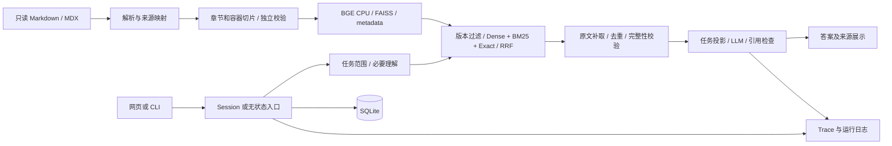

# 技术设计与当前实现

核对日期：2026-10-29；对应业务文件身份见 [项目入口](../README.md)。这是实现说明，不是另一次技术选型。演变原因见 [决策记录](DECISIONS.md)。

## 架构与技术边界

Python/FastAPI/Uvicorn 服务，原生 HTML/JavaScript 页面；SQLite 保存本机 Session，FAISS 保存本地归一化向量。SentenceTransformer 在 CPU 上加载 BGE；requests 调用兼容 Chat Completions 的服务。运行依赖固定于 [requirements-lock.txt](../requirements-lock.txt)，宽范围需求见 [requirements.txt](../requirements.txt)。未迁移到 LangGraph/Haystack/LlamaIndex；没有 Agent、在线 Judge、Reranker、知识图谱或独立向量数据库。

## 数据处理与构建

[config.json](../config.json) 统一指定来源、数据目录、模型与检索默认值。当前读取 `doris-website-master/doris-website-master` 中三个中文系列：4.x 1,572、3.x 1,308、2.1 1,229，共 4,109 份；4,088 份正文非空、21 份空正文留清单，不制造片段。

处理流程：

1. 读取 `.md/.mdx`，处理 UTF-8 BOM、front matter；记录来源路径、URL、目录版本、主题、标题、原始/清洗哈希。
2. 状态化识别围栏、标题、Tabs/TabItem 和提示框，保留父章节、容器作用域、正文版本条件及清洗字符到原文行的映射。HTML 表格转换保留内容；未知结构保守保留并列复核。
3. 按章节和作用域切片；不因短小合并无关章节。代码、表格及说明尽量关联；超长内容分片保留范围、重复表头/回取标记，不假称原文完整。
4. 独立校验源 SHA、正文覆盖、原代码内容、来源跨度、token 预算及配置身份，通过后才编码。
5. 按 token 数与 chunk ID 确定编码/metadata 顺序，保存模型权重/tokenizer 指纹；支持身份完全相同的断点续算。完成后校验向量/FAISS/metadata 的数量、顺序、维度和哈希，再原子切换活动指针。

正文目标 **340 tokens**；加入标题、Tab 标签及特殊 token 后，embedding 输入总预算 **512 tokens**。模型为 `BAAI/bge-base-zh-v1.5`，输出原生 **768 维**。512 是输入文本的 token 数上限，768 是输出向量的数值个数，二者不是同一种长度。当前 batch 32、torch threads 8、`local_files_only=true`；查询加配置中的中文检索前缀。

| 产物 | 作用 |
| --- | --- |
| `data/round1_20261023/processed/documents.jsonl` | 清洗正文、章节与来源映射 |
| `processed/chunks.jsonl`（同一 data_dir） | 检索正文、父章节、容器、表格/代码关联、版本条件及原文跨度 |
| `manifests/` | import_audit、parse_anomalies、document_coverage、chunk_audit、verification 等质量与身份记录 |
| `builds/<build_id>/` | 向量、FAISS、metadata、模型身份和构建 manifest |
| `index/current.json` | 活动已完成构建指针 |

当前构建 `c2774ec931ef-f3bc55d5a4` 共 **51,391** chunks：4.x 22,287、3.x 15,508、2.1 13,596，使用归一化向量及 FAISS `IndexFlatIP`。此处数量来自清单及已有验收，不是本次重新扫描全库的结果。

`prepare` 会写处理中间文件和清单，`verify` 会写检查；两者不是只读健康检查。`build` 即使复用已有完整身份也会校验并可能切换指针。Web 就绪门禁还核对固定路径 `reports/round1_20261023/build_checks.json`、构建状态与活动 ID；换 data_dir 并不自动完成新版本发布。迁移/重建注意事项见 [运维](OPERATIONS.md)。

## 查询与检索契约

`Session → Query Plan → Retrieval → Context → Generation` 传递已确认任务与范围，后层不重新猜用户本轮目标。

| 字段/对象 | 含义与约束 |
| --- | --- |
| `raw_query` | 最新一次原始用户输入 |
| `goal` | 当前活动目标，不能被“其他版本呢”覆盖成无对象任务 |
| `material_query` | 当前有效用户材料组成的查询材料；历史日志不当作新的用户要求 |
| `interpreted_goal` | 理解模型归纳，不冒充用户逐字原话 |
| `comparison_objects` | 对象由前层建立/纠正，后层只消费，不重造对象 |
| `resolved_scope` / `version_scope` | 已解析来源范围与角色；保留环境事实但检索只用本轮范围 |
| `facts` / 条件/假设/子问题 | 复杂材料结构化结果，须通过逐字引用、类型及来源范围校验 |

简单知识问题用规则解析版本、技术标识符及目标，无额外查询理解调用。日志、SQL、配置、长材料或复杂目标才用 LLM 提取。当前提取上限 3,500 output tokens；`ExtractionValidationError` 可触发**一次**重提取，服务错误不重试。原契约的一次分析上限未完全保持，见 [产品差异](PRODUCT.md)。基础/补充子问题通常最多三个；`ensure_task_query` 在必要时补入原任务，实际检索接受 **1–4** 个，不能再写成任何情况下最多三问。没有证据或合法提取时失败关闭，不把原始长材料直接向量化兜底。

检索实现：

- 每个子问题按来源版本预过滤，再分别计算 Dense、BM25、完整技术字符串/错误原串通道；技术标识符须完整边界，错误原串保留内部空格和标点。
- RRF 常数 60；先分组融合，再合并子问题×版本的结果，不把不同通道原分数直接相加。查询向量批量编码，并在多个版本间复用。
- 默认 `hybrid_precise`、`top_k=5`；`hybrid` 同样使用上述融合，`dense`/`lexical` 用于通道对照。检索池通常为 `max(50, top_k*10)`；编码不静默截断超预算查询。
- 在既有有效候选内保障版本、基础规则/Tab、比较对象、显式多词技术名称×版本和子问题覆盖，再按融合结果填充。所有约束仍受主选预算限制；有候选不等于一定全部选中。最新显式名称留位不是隐含诊断对象的通用识别器。
- 可共享补充至多一个符合条件的跨版本对应或明确局部引用候选，不能搜索范围外版本。最终送模单元可能多于五个；主选 Top-K 没有因此提高。
- 原文补取后去除同版本、同来源 SHA/作用域且完整包含的冗余，保留独立条件；必要时从已有合法候选补位，没有新增一轮广泛召回。

## 上下文与生成

`context.py` 依据原文行号/字符跨度、源 SHA、父章节、关联块与容器补取：本片、关联代码/表格、章节条件、Tab 与提示框规则、功能短章或显式引用。单段最多 **4,000 字符**、总预算 **14,000 字符**；这是字符预算，与 embedding token 预算不同。长表格优先取命中原文完整行；一行本身超过预算不能伪装完整。补取结果带原文位置和完整性标记，原文身份不匹配则停止使用。

生成前建立并核对任务投影：`latest_request`、`topic_goal`、`comparison_objects`、`requested_scope`、`answer_operation`。实际第一条任务 JSON 必须与本轮契约一致。消息包含任务投影、有效用户材料、计划摘要、选中原文及版本条件；不把全部聊天消息无差别堆入模型，也不把旧回答作为用户事实。

当前生成 temperature 0.1、max_tokens 6,000；连接超时 10s、读取超时 120s。模型服务兼容层包含特定 DeepSeek 配置适配，不能外推为所有兼容服务都支持相同参数。要求非空内容、`finish_reason=stop` 及有效引用，截断/非法引用失败关闭；无自动网络重试、无在线语义 Judge。引用检查是结构验证，不能阻止全部无依据技术断言。

诊断时必须检查 `model_calls[].request.messages` 中**实际送模**原文；`generation.input_rows`、候选池、补取结果和最终 `result.evidence`（被引用子集）不是同一个集合。轻量 Trace 不含完整消息，不能事后恢复未保存正文。

## Session、状态与并发

SQLite 保存会话消息、活动状态、revision、重试快照与 attempt。规则先识别明确新任务/追问/补充/纠正；不明确的关系先保留活动状态，允许一次 **700 tokens** 的关系判断，只返回受限枚举，不重写事实、任务或版本。失败保留状态，模糊关系进入澄清；下一轮确定关系后再进问答。该有限调用不是多 Agent 编排。

新任务清理无关活动条件与比较对象；历史消息保留。原始材料与纠正后的有效材料分开，活动原材料最多 8 项/30,000 字符；超限拒绝并提示精简或新建，不静默截掉旧材料。单输入接口最多 32,000 字符，因此满足HTTP长度限制仍可能超过活动任务预算。长期连续聊天并不意味着所有历史材料无限参与本轮。

写操作用 `BEGIN IMMEDIATE`、busy/revision/attempt 校验防覆盖；SQLite 连接随操作关闭、timeout 10s。同一 Session 处理中不接受冲突写入；共享请求容量 4，后台执行器 2 个 worker，其余有限排队。删除或过期 attempt 在开始调用前会检查，但已发出的上游请求不能即时取消。

服务创建 SessionStore 时将遗留 busy 任务恢复为 interrupted 并增加 revision，因此构造存储对象不是只读审计。用户显式重试最后一个符合条件的失败：复用消息 ID、新 attempt_id，保留旧失败历史和请求快照，不追加同一用户消息。重试使用当前代码/模型/索引，不是历史运行环境完全回放。

浏览器保存当前会话 ID 与各会话草稿；切换/刷新用 epoch 防旧请求覆盖新页面，回执不明先取状态确认。页面轮询状态，无 SSE、WebSocket 或 token 流式输出。

## HTTP 接口

| 方法和路径 | 用途/主要输入 |
| --- | --- |
| `GET /`、`GET /app.js` | 页面和脚本 |
| `GET /api/status` | index_ready、llm_configured、retrieval_ready、warmup_status、默认范围与审计摘要；可触发本地预热，不测试 LLM 连通性 |
| `POST /api/ask` | 无状态 query、version、top_k、mode、evidence_only、diagnostic |
| `GET /api/sessions`、`POST /api/sessions` | 历史列表/创建，创建返回 201 |
| `GET /api/sessions/{sid}` | 消息及状态投影 |
| `PATCH /api/sessions/{sid}` | title、revision；HTTP 字段最多80，业务规则最多40字符 |
| `DELETE /api/sessions/{sid}` | 删除，成功204 |
| `POST /api/sessions/{sid}/turns` | query、可选 revision、diagnostic；202表示已接受 |
| `POST /api/sessions/{sid}/messages/{mid}/retry` | revision、diagnostic；202表示已接受 |
| `GET /api/source?doc_id=...&start_line=...&end_line=...` | 允许列表内原文位置，核验来源路径、SHA并转义展示 |

query 长度 1–32,000；无状态 top_k 1–15，默认5；diagnostic 默认 false。输入/来源错误常见400/404、冲突409、结构错误422、未就绪/容量/存储故障503；无状态模型异常可能502。后台 Session 失败通常在后续 GET 的回答状态中返回，不一定表现为 GET HTTP 5xx。错误向浏览器隐藏服务地址、认证头和原始服务响应。生产只绑定127.0.0.1，没有企业身份/授权层。

## 模块与可观测性

| 模块 | 职责 |
| --- | --- |
| `common.py`、`documents.py`、`markdown.py`、`html_tables.py` | 配置/模型身份、解析、清洗和来源 |
| `chunking.py`、`audit.py`、`indexing.py` | 切片、独立验证、编码构建与原子指针 |
| `query_understanding.py`、`lexical.py`、`retrieval.py` | 任务理解、词法/精确命中、混合召回与选位 |
| `context.py`、`generation.py`、`pipeline.py` | 来源补取、任务投影/模型/引用、统一查询编排 |
| `sessions.py`、`web.py`、`presentation.py`、`ui/` | 活动任务、持久化、HTTP、对用户投影和页面 |
| `telemetry.py`、`runtime_logging.py` | 请求 Trace、身份、用量和运行日志 |
| `evaluation.py`、`evaluation_semantics.py` | 旧诊断入口、V2 重评分/当前运行与独立语义判定支持 |
| `__main__.py`、`__init__.py` | 命令行与包入口 |

Trace 默认为轻量：身份、阶段、数量、选择位置、哈希、用量、错误，不含问题/文档正文、完整 messages 或原始模型响应。`diagnostic=true` 才保存脱敏后的完整诊断。每请求增量 `.jsonl`，完成时原子生成 `.json`；`load_trace` 支持日志恢复，忽略不完整尾行，拒绝中间损坏/断序。保存失败有诊断标记，不将已完成答案改成失败。身份文件复用哈希；进程代码身份及磁盘漂移另行标记，不能用磁盘 SHA 证明旧进程已更新。

`stages.seconds` 排除测得的同步记录耗时，但父子仍嵌套；`wall_seconds`、`logging_seconds`、HTTP `model_calls.seconds` 各有边界，不能相加当总时间。pipeline 的 `timings.llm_calls` 不含前置 Session 关系调用，计费审计看整个请求 Trace 的 `model_calls`。运行日志按北京时间记录日期追加到 `logs/runtime/server-YYYY-MM-DD.log`；两类日志均无自动过期。更多使用与保护要求见 [运维](OPERATIONS.md)。
